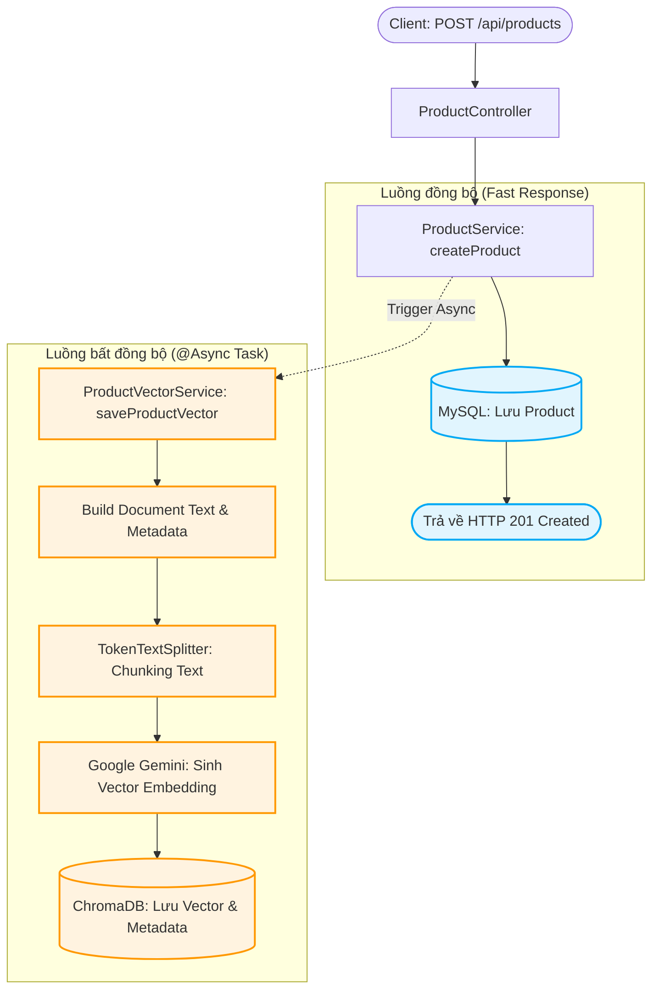
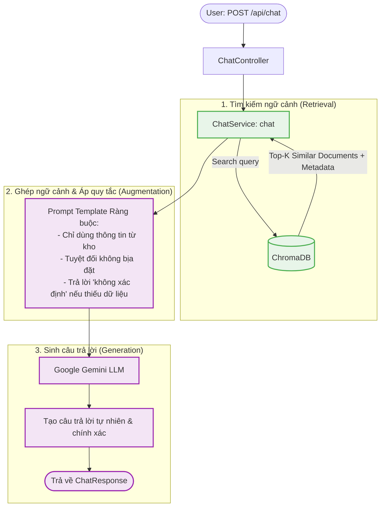

# 🛍️ AI Chatbot with RAG

> Tính năng Chatbot tra cứu sản phẩmứng dụng kiến trúc **RAG (Retrieval-Augmented Generation)** xây dựng trên nền tảng **Java 23**, **Spring Boot**, **Spring AI**, **Google Gemini** và **ChromaDB**.

---

## 🔄 Kiến trúc & Flowchart 2 luồng API cốt lõi

### Luồng 1: API Thêm sản phẩm & Tự động nạp Vector bất đồng bộ (`POST /api/products`)

Khi admin thêm sản phẩm mới vào hệ thống, dữ liệu được lưu tức thì vào MySQL và kích hoạt luồng `@Async` để trích xuất embedding nạp vào ChromaDB mà không làm block API.



---

### Luồng 2: API Chat & Tra cứu sản phẩm thông minh bằng RAG (`POST /api/chat`)

Khi khách hàng gửi câu hỏi tư vấn, hệ thống tìm kiếm các sản phẩm tương đồng nhất trong ChromaDB, ghép vào Prompt có quy tắc kiểm duyệt và gửi đến Google Gemini để sinh câu trả lời.



---

## 📡 Danh sách API chính (API Endpoints)

### 1. Thêm sản phẩm mới
* **Endpoint:** `POST /api/products`
* **Request Body:**
```json
{
  "name": "Bàn phím cơ không dây MonsGeek M1W",
  "price": 2350000,
  "description": "Bàn phím nhôm CNC, 3 mode kết nối, mạch xuôi, gasket mount",
  "stockQuantity": 20
}
```
* **Response (HTTP 201):**
```json
{
  "success": true,
  "message": "Tạo sản phẩm thành công",
  "data": {
    "id": 6,
    "name": "Bàn phím cơ không dây MonsGeek M1W",
    "price": 2350000,
    "stockQuantity": 20
  }
}
```

---

### 2. Chat / Tra cứu sản phẩm (RAG)
* **Endpoint:** `POST /api/chat`
* **Request Body:**
```json
{
  "message": "Tôi đang tìm một chiếc bàn phím cơ kết nối không dây, giá tầm hơn 1 triệu chút"
}
```
* **Response (HTTP 200):**
```json
{
  "success": true,
  "message": "Trả lời thành công",
  "data": {
    "answer": "Chào bạn, cửa hàng có sản phẩm Bàn phím cơ không dây RK84 với giá 1.250.000 VNĐ. Sản phẩm hỗ trợ 3 mode kết nối (Bluetooth/2.4G/Type-C) và có tính năng Hotswap RGB, hiện còn 50 chiếc trong kho."
  }
}
```
